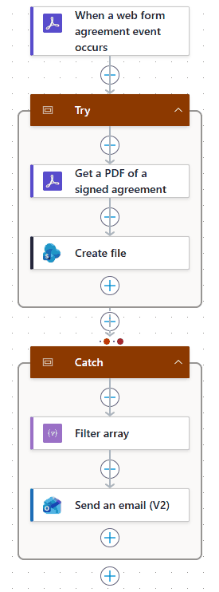
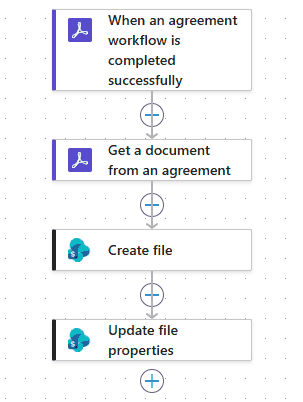
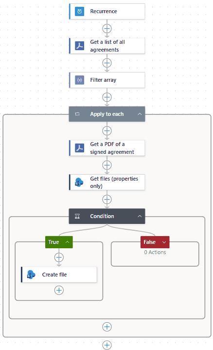

# NDA sync to SharePoint

**Status:** Live\
**My role:** Built\
**Stack:** Adobe Acrobat Sign, Power Automate, SharePoint Online, Outlook

## Problem

Visitor NDAs were signed on paper and filed by hand, with no easy way to track them.

## How it works

Every signed NDA lands in a SharePoint document library as soon as Acrobat Sign reports it signed. Two flows handle this, one for each way an NDA gets signed.

### Front desk web form

Visitors sign at the front desk through an Acrobat Sign web form. The Save Visitor NDA Web Form to SharePoint flow files those:

1. Fires on a web form agreement event in Acrobat Sign.
2. A Try scope gets the signed PDF and creates the file in SharePoint.
3. If Try fails or times out, a Catch scope runs. It filters the Try results down to the step that didn't succeed, emails an alert with the failed step, the error message, and a link to the run, then ends the run as Failed so it shows up in run history.



The Catch scope, with the alert address replaced:

```json
"Catch": {
  "type": "Scope",
  "runAfter": { "Try": ["TimedOut", "Failed"] },
  "actions": {
    "Filter_array": {
      "type": "Query",
      "inputs": {
        "from": "@result('Try')",
        "where": "@not(contains(createArray('Succeeded', 'Skipped'), item()?['status']))"
      }
    },
    "Send_an_email_(V2)": {
      "runAfter": { "Filter_array": ["Succeeded"] },
      "inputs": {
        "parameters": {
          "emailMessage/To": "it-alerts@example.com",
          "emailMessage/Subject": "Visitor NDA web form flow failed - Agreement @{triggerOutputs()?['body/agreement/id']}"
        }
      }
    },
    "Terminate": {
      "type": "Terminate",
      "runAfter": { "Send_an_email_(V2)": ["Succeeded"] },
      "inputs": { "runStatus": "Failed" }
    }
  }
}
```

The email body is built from three expressions:

| Line | Expression |
|---|---|
| Failed step | `@{first(body('Filter_array'))?['name']}` |
| Error | `@{coalesce(first(body('Filter_array'))?['error']?['message'], string(first(body('Filter_array'))?['outputs']?['body']))}` |
| Run link | `@{concat('https://make.powerautomate.com/environments/', workflow()?['tags']?['environmentName'], '/flows/', workflow()?['name'], '/runs/', workflow()?['run']?['name'])}` |

The filter matches any status other than Succeeded or Skipped, so a timed-out step is caught the same way as a failed one. The error line falls back to the step's output body when there's no error message, and the run link opens the failed run directly.

### Emailed NDAs

NDAs sent by email go through the Save Signed NDA to SharePoint flow. It fires when an agreement workflow completes, saves the signed PDF to SharePoint, logs each NDA to a sync log list, and emails an alert when a run fails.



## Earlier version

The first version was Save Signed NDA to SharePoint on its own. After hitting limits in its trigger, I replaced it with one scheduled flow that listed every agreement on a recurrence and checked SharePoint for an existing file before saving each one. I've since retired the scheduled flow. Save Signed NDA to SharePoint is back with logging and failure alerts added, and web form NDAs have their own flow.


