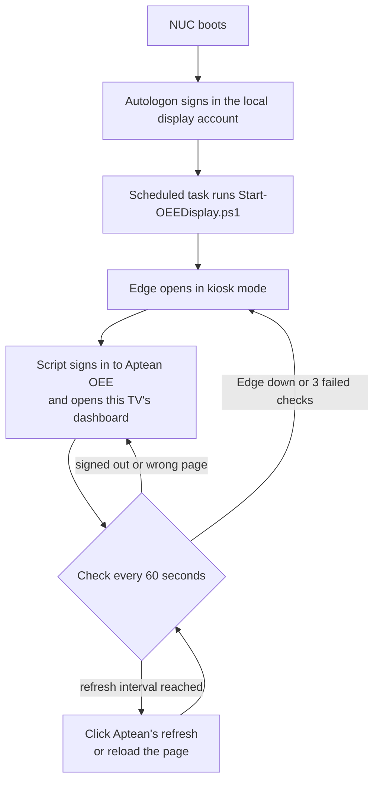

# Production dashboard kiosks

**Status:** Rolling out (script sets built for 4 of 6 displays)\
**My role:** Owner\
**Stack:** PowerShell, Windows, Intel NUC, Microsoft Edge kiosk mode, Chrome DevTools Protocol, Sysinternals Autologon, Aptean OEE

## Problem

Six TVs on the production floor show Aptean OEE (overall equipment effectiveness) dashboards, each driven by an Intel NUC. Without automation, a reboot, an expired session, or a pop-up leaves a TV on a sign-in screen or the wrong page until someone walks over and fixes it.

## How it works

| Script | What it does |
|---|---|
| [Setup-OEETV.ps1](scripts/Setup-OEETV.ps1) | One-shot setup. Confirms it's elevated and on the right NUC, creates the local display account, configures Autologon, runs the other two installers, and reboots. |
| [Install-OEEDisplay.ps1](scripts/Install-OEEDisplay.ps1) | Copies the scripts to `C:\OEEDisplay`, turns off sleep and screen timeout, and registers the "OEE Display" scheduled task to run at the display account's logon. |
| [Set-OEECredential.ps1](scripts/Set-OEECredential.ps1) | Prompts for the Aptean login, encrypts it with machine-scope DPAPI, and locks the file to SYSTEM, Administrators, and the display account (read only). |
| [Start-OEEDisplay.ps1](scripts/Start-OEEDisplay.ps1) | Runs the display: launches Edge in kiosk mode, signs in, keeps the dashboard on screen, refreshes on a timer, and relaunches Edge when it hangs. |

## Design decisions

- **Local, non-admin display accounts.** Each NUC signs in to its own local account in the Users group, and setup warns if that account is a local admin. An unattended, signed-in session on the floor has no domain access.
- **Autologon, not plain-text registry values.** Sysinternals Autologon stores the display account's password as an LSA secret instead of in plain text under the Winlogon key.
- **Encrypted app credentials.** The Aptean login is encrypted with machine-scope DPAPI, so the file can't be decrypted on any other PC.
- **Browser control over the DevTools Protocol.** The script drives Edge through the Chrome DevTools Protocol on a local debug port. It finds the login form even inside Aptean's frames, fills it, and clicks through to the TV's dashboard by name.
- **App refresh first.** The refresh clicks Aptean's own refresh control, which keeps the session and the current screen. A full page reload is the fallback.
- **Pop-up suppression.** The script stubs out `alert()` and `confirm()` in every frame so an Aptean pop-up can't freeze the page.
- **Self-healing.** If Edge stops responding, or three checks in a row fail, the script kills and relaunches Edge. The scheduled task restarts the script up to 5 times if it fails.
- **Waits for the network.** On boot, the script waits up to 5 minutes for DNS before launching Edge, so a slow Wi-Fi join doesn't leave the TV on an error page.
- **Maintenance mode.** A file named `STOP` in `C:\OEEDisplay` stops the script, so IT can work on the NUC without the watchdog relaunching Edge.
- **Hostname guard.** Each TV's setup script refuses to run on any NUC but its own.
- **One script set per TV.** Each display keeps its own copy, and the copies differ only in their config values. The scripts in this repo are the generic template.

## Setup

1. Copy the four scripts to the NUC.
2. Set the config values: `$StartUrl` and `$DashboardText` in Start-OEEDisplay.ps1, and `$TVName`, `$ExpectedPC`, and `$DisplayUser` in Setup-OEETV.ps1.
3. Run Setup-OEETV.ps1 in an elevated PowerShell. It prompts for the display account's Windows password and the Aptean login, then reboots.

## Network

The NUCs started on the IoT wireless network, and one kept dropping off Wi-Fi. I recommended moving the dashboard TVs to Ethernet.
