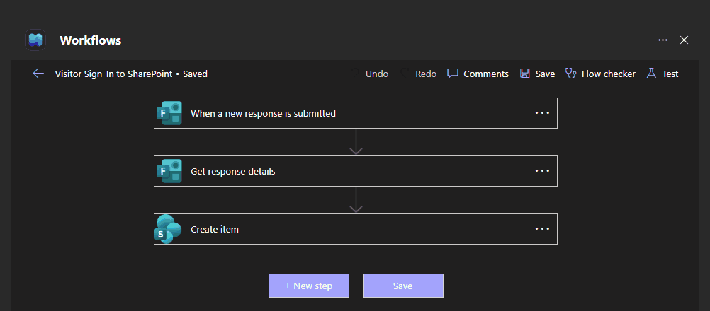
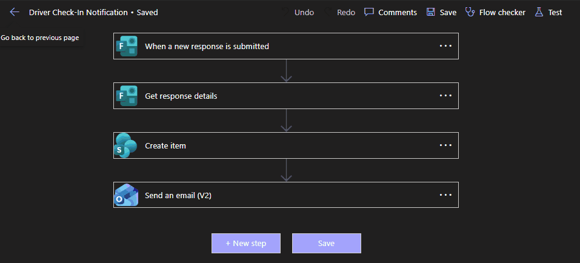

# Visitor sign-in kiosk

**Status:** Live\
**My role:** Built and maintain\
**Stack:** Microsoft Forms, Power Automate, SharePoint Online, Outlook

## Visitor sign-in

Visitors sign in at a kiosk at the front desk. Each Forms submission triggers a Power Automate flow that pulls the response details and creates an item in a SharePoint list, which is the visitor log.

## Driver check-in

A second flow uses the same pattern for driver check-ins and adds an email notification after the SharePoint item is created.

## Work done

- Built the forms, flows, and SharePoint lists.
- Fixed a UTC offset bug that put log timestamps five hours off.
- Reworked the kiosk front end to be faster and easier for visitors to use.
